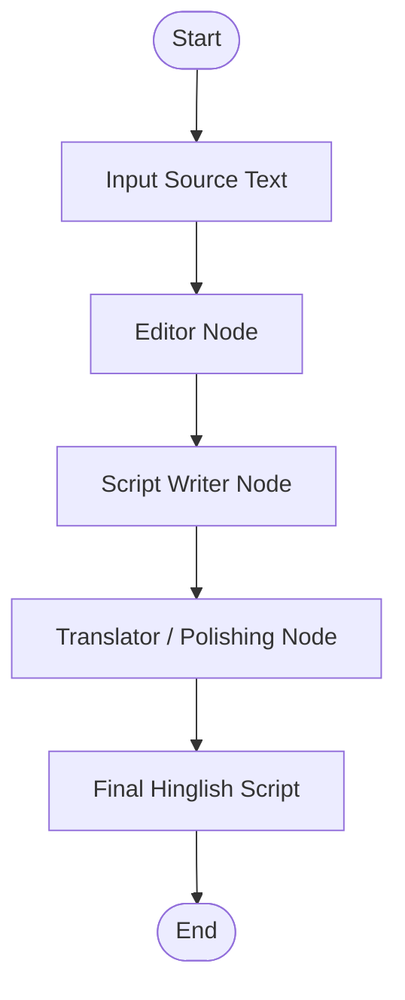

# ScriptSage AI 🎬

**ScriptSage AI** is a Python-based AI script generation project built using **LangGraph** and **Groq LLM**. It transforms source text into a polished, engaging Hinglish script through a sequential workflow of three AI nodes.

## Features

- **Text Editing:** Corrects grammar, spelling, punctuation, and sentence structure.
- **Script Generation:** Converts edited text into a concise, engaging Hinglish script.
- **Script Polishing:** Improves grammar, readability, and word spacing in the final script.
- **Sequential Workflow:** Processes text through three connected LangGraph nodes.
- **Source-Based Content:** Prompts the model to preserve the original meaning and avoid unsupported information.
- **Environment Variables:** Keeps the Groq API key in a `.env` file.

## Tech Stack

- Python
- LangGraph
- LangChain
- Groq LLM
- python-dotenv
- TypedDict

## Workflow

The project follows a sequential workflow in which each node processes the output of the previous node.



### Workflow Steps

**1. Editor Node**
- Receives the original source text.
- Corrects grammar, spelling, and punctuation.
- Preserves the original meaning and language.
- Stores the result in `edited_txt`.

**2. Script Writer Node**
- Receives the edited text.
- Generates a short, engaging Hinglish script.
- Uses a conversational style suitable for short videos.
- Stores the generated script in `script_txt`.

**3. Translator / Polishing Node**
- Receives the generated Hinglish script.
- Improves grammar, punctuation, readability, and spacing.
- Preserves the script's meaning without intentionally adding new information.
- Stores the final result in `final_output`.

**4. Final Output**
- Displays the edited source text.
- Displays the generated Hinglish script.
- Displays the polished final Hinglish script.

## Project Structure

```text
ScriptSage-AI/
├── project.py
├── .env
├── .gitignore
└── requirements.txt
```

- `project.py` — Contains the LangGraph workflow, node functions, and execution logic.
- `.env` — Stores the Groq API key.
- `.gitignore` — Excludes sensitive files and unnecessary folders from Git.
- `requirements.txt` — Lists the Python dependencies.

## Installation

### 1. Clone the Repository

```bash
git clone https://github.com/azaan03/ScriptSage-AI.git
cd ScriptSage-AI
```

Replace the repository URL if your GitHub repository uses a different name.

### 2. Create a Virtual Environment

```bash
python -m venv .venv
```

Activate it on Windows:

```bash
.venv\Scripts\activate
```

### 3. Install Dependencies

```bash
pip install -r requirements.txt
```

If you have not generated `requirements.txt` yet, install the required packages:

```bash
pip install langgraph langchain-groq python-dotenv
```

### 4. Configure the API Key

Create a `.env` file in the project root:

```env
GROQ_API_KEY=your_groq_api_key
```

Replace `your_groq_api_key` with your actual Groq API key.

**Security:** Never commit your `.env` file or expose your API key on GitHub.

### 5. Run the Project

```bash
python project.py
```

The terminal displays three outputs:

1. Edited Text
2. Short
